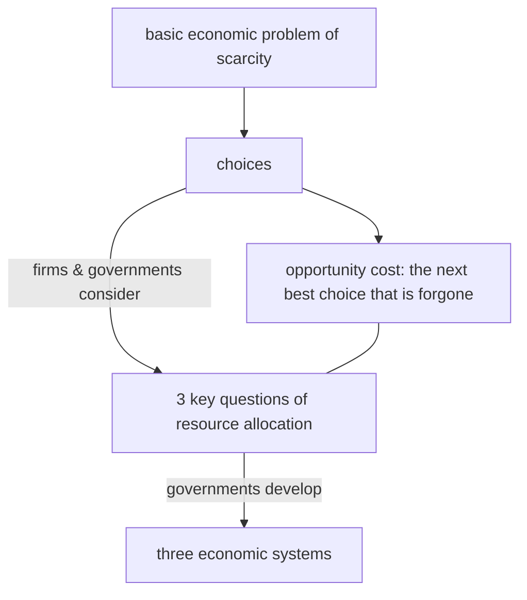
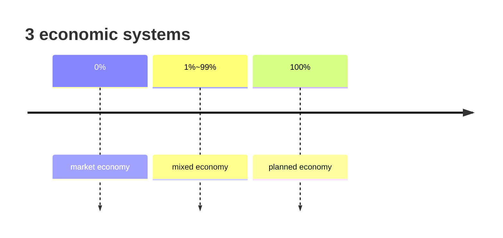

In an economy:

| Sector         | Aim                                   | Includes                   |
| -------------- | ------------------------------------- | -------------------------- |
| private sector | private interest, e.g. maximum profit | private firms, individuals |
| public sector  | improve social welfare                | public firms, government   |

### Three economic systems

| Economic system | Resource allocation | Government intervention  |
| --------------- | ------------------- | ------------------------ |
| planned         | by government       | 100% / no private sector |
| market          | by market           | 0% / no public sector    |
| mixed           | both                | 1% to 99%                |

### Market

A market is a system that brings all producers and all consumers of a good or service together to trade.
