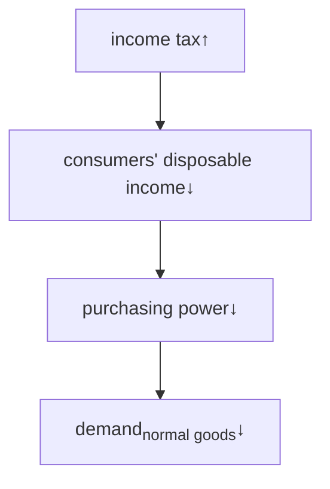

Demand is the willingness and ability to buy a good in a given period.

### Demand curve

The demand curve demonstrates a negative relation between quantity demanded and price.

> To draw a demand curve, price must change.
> The demand curve is usually downward sloping.

### Individual demand

Individual demand is the amount that a consumer is willing and able to buy at a price.

### Market demand

Market demand is the sum of all individual demands at a price.

### Movement along the demand curve

**Reason:** Due to a change in the price of the good.

| Type                  | Reason                                           | Result                                   |
| --------------------- | ------------------------------------------------ | ---------------------------------------- |
| extension in demand   | fall in price causes a rise in quantity demanded | downward movement along the demand curve |
| contraction in demand | rise in price causes a fall in quantity demanded | upward movement along the demand curve   |

### Shift of the demand curve

**Reason:** Due to a change in the non-price factor(s).

| Type        | Reason                                                  | Result                                |
| ----------- | ------------------------------------------------------- | ------------------------------------- |
| right shift | more quantity demanded at each price / a rise in demand | a rightward shift of the demand curve |
| left shift  | less quantity demanded at each price / a fall in demand | a leftward shift of the demand curve  |

### Differences between a contraction in demand and a fall in demand

| Difference            | Figure                             | Reason              | Result                                  |
| --------------------- | ---------------------------------- | ------------------- | --------------------------------------- |
| contraction in demand | point moves along the demand curve | rise in price       | fall in quantity demanded at a price    |
| fall in demand        | the demand curve shifts left       | non-price factor(s) | fall in quantity demanded at each price |

### Non-price factors for shift of demand curve

#### Income / income tax

A rise in income increases consumers' purchasing power, which causes a rise in demand for normal goods and a fall in demand for inferior goods.

**Normal goods:** goods whose demand increases when income increases, e.g. quality food, luxury.

**Inferior goods:** goods whose demand decreases when income increases, e.g. poor quality goods, second-hand goods, trash food, public transport.

A fall in income tax increases consumers' disposable income, which is the difference between their income and income tax.

#### Population

A rise in population increases the quantity of potential consumers.

> e.g. large population due to immigration / high birth rate.

#### Change in the trend (or taste)

A change in the trend can make consumers more willing to purchase certain good(s).

> e.g. advertisement, positive quality report.

#### Price or quality of a substitute

Substitutes are rival goods that can be used instead of another good.

A rise in the price / quality of a substitute decreases the quantity demanded for the substitute and increases the demand for the rival good.

> e.g. tea & coffee.
>
> Positive relation between the price of a substitute and the price of the good.

#### Price or quality of a complement

Complements are goods consumed with another good to have a joint demand.

A rise in the price / quality of a complement decreases the quantity demanded for the complement, which *also* decreases the demand for the corresponding good(s).

> e.g. petrol & car, sports shorts & shirts.
>
> Negative relation between the price of a complement and the price of the good.
