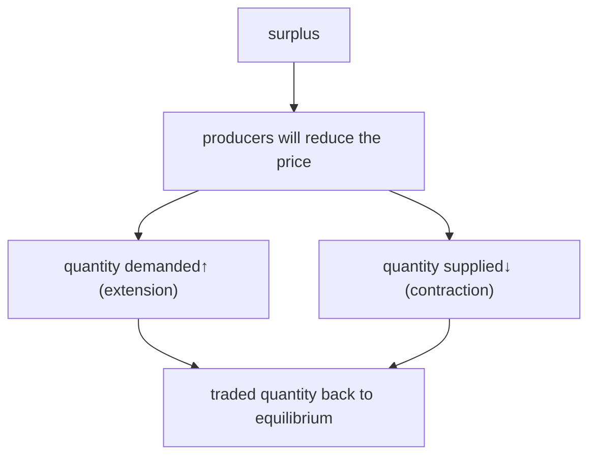
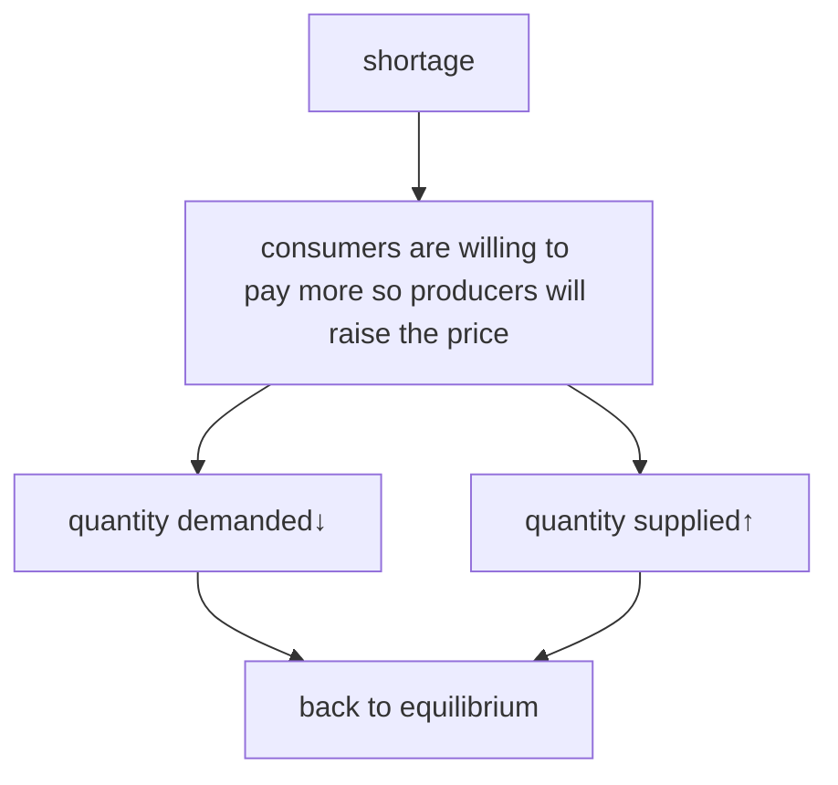

> Consumers want lower prices.
> Producers want higher prices.

A price *rise* is due to demand&uarr; or supply&darr;.
A price *fall* is due to demand&darr; or supply&uarr;.

**The reasons for price changes are the non-price factors of demand and supply, not surplus and shortage.**

### Market equilibrium

Where market demand and market supply are equal, the market is clear and there is no pressure to change price.

**Shown by:**

1. quantity demanded and quantity supplied in the demand/supply schedule
2. intersection in the demand/supply diagram

### Market disequilibrium

Where market demand and supply are not equal, e.g. shortage or surplus.

#### Surplus

Excess supply, quantity supplied &gt; quantity demanded.

**Reason:** Price rises above equilibrium &rarr; quantity supplied &gt; quantity demanded &rarr; surplus.

**Result:**

#### Shortage

Excess demand, quantity supplied &lt; quantity demanded.

**Reason:** Price falls below equilibrium &rarr; quantity supplied &lt; quantity demanded &rarr; shortage.

**Result:**

