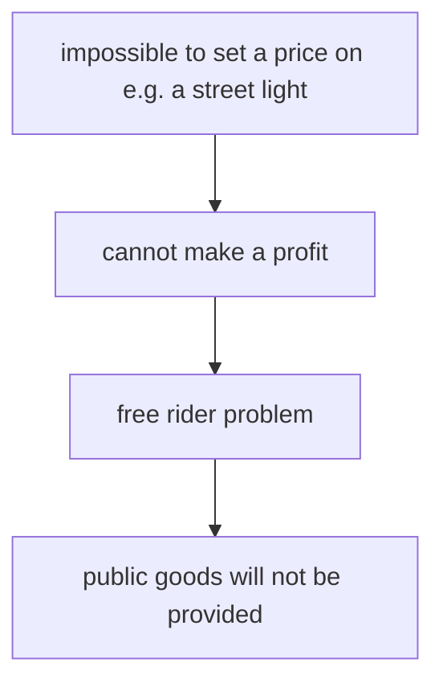

### Disadvantages of a market economy

#### 1. Inequality

Also called uneven distribution of income: some people are very rich while others live in poverty.

#### 2. Inefficiency (= market failure)

Also called resource misallocation: the market allocates resources inefficiently.

### 5 aspects of market failure

#### 1. Monopoly may arise

A large firm may take over small firms, so it abuses market power, e.g. by charging a high price / offering limited choices.

#### 2. Public goods will not be provided

It is impossible to set a price on e.g. a street light. Therefore no profit can be made, causing the free rider problem.

> **Public goods ≠ free goods**
>
> Public goods are goods that are non-excludable and non-rival, causing the free rider problem.
>
> **Non-excludable:** impossible to exclude those who do not pay from using it.
>
> **Non-rival:** if a person consumes a good, it does not reduce the availability for others.
>
> **Free rider:** no one wants to pay, so a price cannot be set on public goods and they are not profitable to produce.
>
> e.g. street light, lighthouse, national park, national defence, police force, flood defence.

#### 3. Private sector firms do not consider external cost

Private sector firms aim for maximum profit, so they do not take measures to control pollution &rarr; goods are over-produced.

| Concept          | Definition                                                                                            | Example                                           |
| ---------------- | ----------------------------------------------------------------------------------------------------- | ------------------------------------------------- |
| private cost     | negative effect on the producers and consumers                                                        |                                                   |
| external cost    | negative effect on a third party who is not directly involved in the decision                         | waste, noise                                      |
| social cost      | private cost + external cost: total costs to society, including private and external costs            |                                                   |
| private benefit  | positive effect on the producer and consumer                                                          | satisfaction for consumers, revenue for producers |
| external benefit | positive effect on a third party who is not directly involved in the decision                         | tax paid to governments, high employment          |
| social benefit   | private benefit + external benefit: total benefit to society, including private and external benefits |                                                   |

#### 4. Demerit goods may be over-consumed (or over-produced)

Due to information failure, consumers do not consider (or under-estimate) external costs, e.g. second-hand smoking.

> **Demerit good:** goods that people underestimate social costs, and are therefore over-consumed due to information failure.
>
> e.g. cigarette, alcohol, drug, violent video game &rarr; inelastic PED as it is addictive

#### 5. Merit goods may be under-consumed

Due to information failure, consumers do not consider external benefit, e.g. education creates more skilled workers.

> **Merit good:** goods that people may underestimate social benefits, and are therefore under-consumed due to information failure.
>
> e.g. education, healthcare, vaccination, fruit

### Summary of market failure

| Market failure                             | Examples                    | Reason                                       |
| ------------------------------------------ | --------------------------- | -------------------------------------------- |
| no public goods                            | street lights, police force | free rider                                   |
| merit goods are under-consumed             | education, healthcare       | information failure, ignore external benefit |
| goods with external cost are over-produced | pollution                   | aim for maximum profit, ignore external cost |
| monopoly                                   | N/A                         | abuse market power                           |

> Market failure = 4 occasions where goods aren't properly provided.

### What is not market failure

1. Problems that the market can solve. E.g. shortage of care &rarr; price &uarr; &rarr; quantity demanded &darr; + quantity supplied &uarr; &rarr; equilibrium
2. Problems that don't belong to the market economy. E.g. scarcity
3. Not inefficiency. E.g. inequality, poverty
